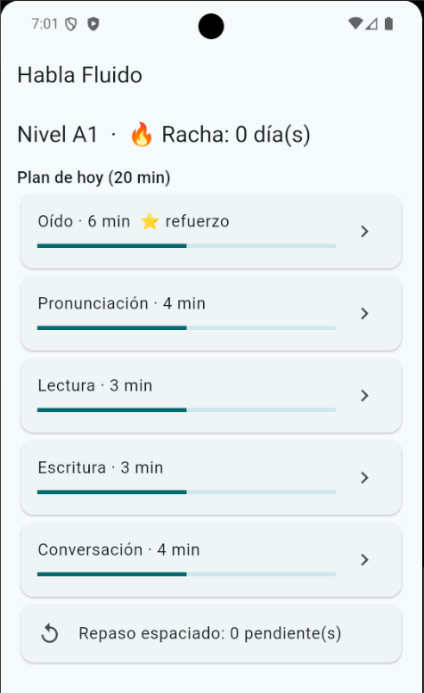
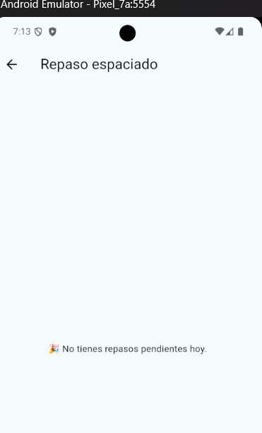
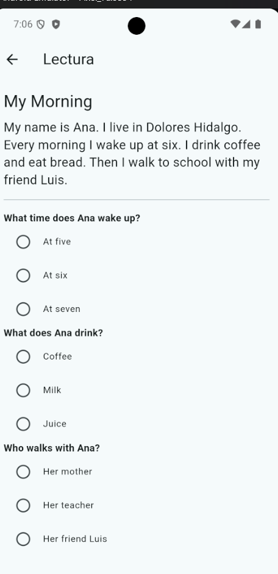
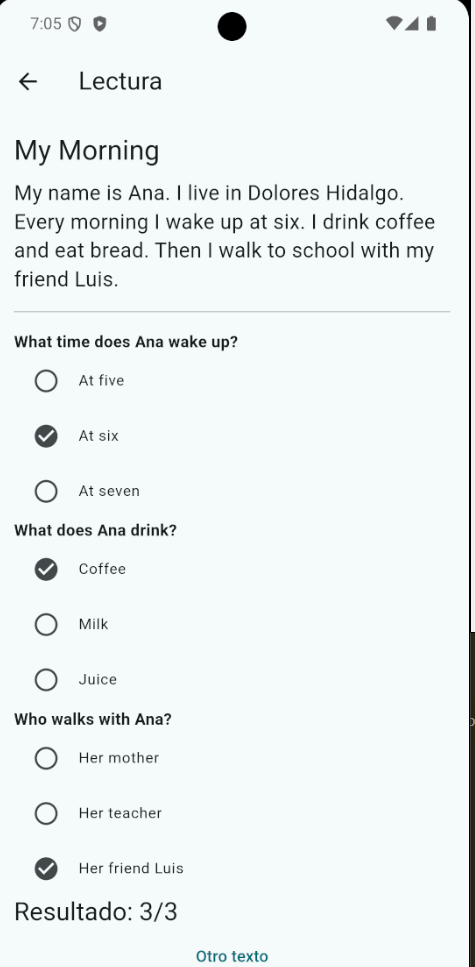
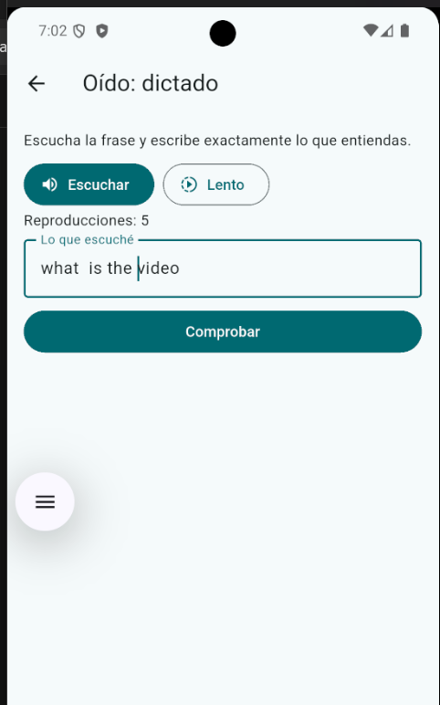
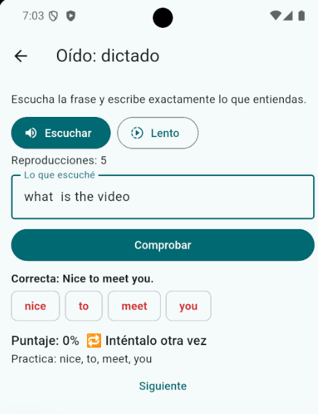
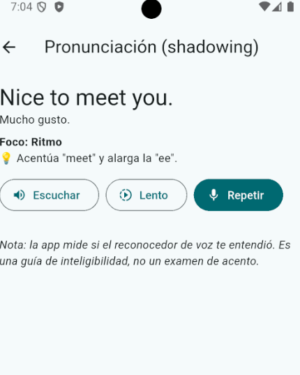
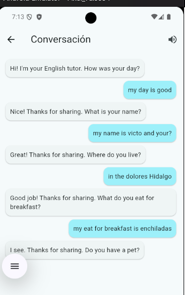
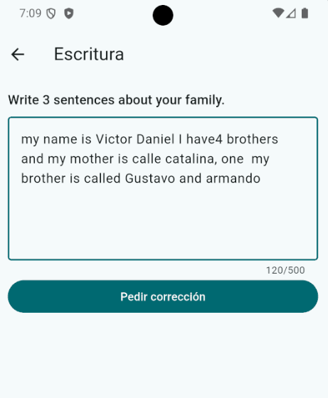
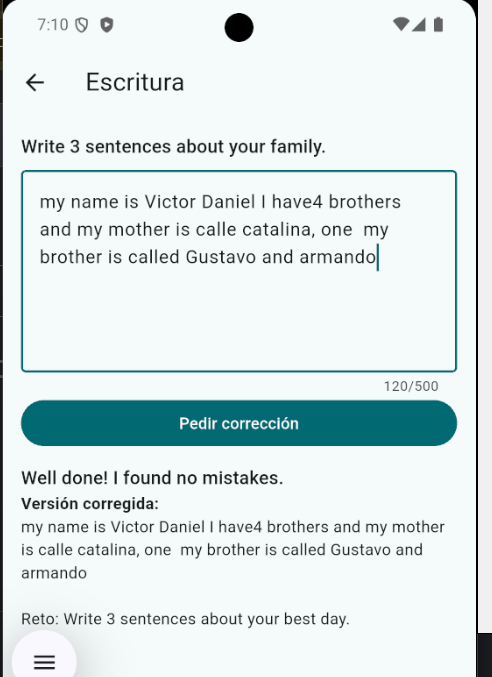

# Habla Fluido

Aplicación móvil desarrollada con **Flutter** enfocada en la práctica y mejora de habilidades lingüísticas a través de módulos interactivos de lectura, escucha, pronunciación, escritura y conversación.

## Módulos y funcionalidades

* **Inicio:** Acceso principal a las distintas secciones y actividades de práctica.
* **Lectura y comprobación de lectura:** Lectura de textos y validación de comprensión.
* **Escucha (oído) y comprobación de oído:** Ejercicios de comprensión auditiva y verificación.
* **Pronunciación:** Práctica oral para mejorar la articulación y fluidez.
* **Escritura y escritura corregida:** Redacción guiada y revisión/corrección de textos.
* **Conversación:** Práctica interactiva de diálogo.
* **Repaso:** Refuerzo de contenidos y actividades vistas.

## Capturas de pantalla

| Inicio | Repaso |
| :---: | :---: |
|  |  |

| Lectura | Comprobación de lectura |
| :---: | :---: |
|  |  |

| Prueba de oído | Comprobación de oído |
| :---: | :---: |
|  |  |

| Pronunciación | Conversación |
| :---: | :---: |
|  |  |

| Escritura | Escritura corregida |
| :---: | :---: |
|  |  |

## Ejecución local

1. Clona el repositorio:
   ```bash
   git clone [https://github.com/vic0307/habla_fluido.git](https://github.com/vic0307/habla_fluido.git)
